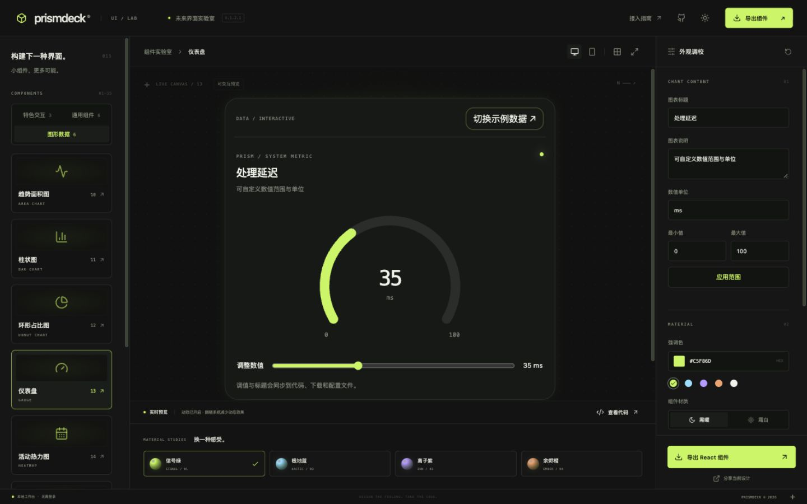

# PrismDeck · 未来界面实验室

15 个可复用 React 组件：3 个特色交互 + 6 个通用控件 + 6 个图形数据组件。在线调校、实际操作预览，带走 React + CSS 源码。

[在线工作台](https://batype.github.io/prismdeck/) · [GitHub](https://github.com/batype/prismdeck)



## 使用 npm 组件

```sh
npm install @batype/prismdeck
```

```tsx
import { useState } from "react";
import { SpatialCard, OrbitDial, CommandDock } from "@batype/prismdeck";
import "@batype/prismdeck/style.css";

export default function Demo() {
  const [value, setValue] = useState(64);
  return (
    <OrbitDial
      value={value}
      onChange={setValue}
      config={{ accent: "#8ce2ff", surface: "dark", radius: 20 }}
    />
  );
}
```

需要 React 18.2+。运行时只依赖 React；CSS 独立引入，无需 Tailwind、Canvas、WebGL 或动画运行时。

## 组件目录

| 组件              | 核心行为                                  | 业务接入                                                           |
| ----------------- | ----------------------------------------- | ------------------------------------------------------------------ |
| `SpatialCard`     | 指针跟随层次、轨道与呼吸动效              | `onAction` 与 `actionLabel` 接入真实动作                           |
| `OrbitDial`       | 圆周拖动、0–100 数值控制、标准滑条        | 受控 `value` / `onChange`，支持 `disabled`                         |
| `CommandDock`     | 图标导航、活动状态、悬停与焦点标签        | 受控 `value` / `onChange`，可自定义 `items`                        |
| `PrismButton`     | solid / outline / ghost、三种尺寸、加载态 | 原生 button 属性，`loading` 时禁用点击，默认 type=button           |
| `PrismInput`      | 标签、辅助文案、错误与禁用态              | 原生 input 属性及 ref，支持受控和 defaultValue                     |
| `PrismSwitch`     | 设置开关、键盘与原生表单值                | `checked` / `onCheckedChange`、name / value / disabled             |
| `PrismTabs`       | 标签页及内容面板                          | `items` / `value` / `onValueChange`，方向键、Home / End 跳过禁用项 |
| `PrismBadge`      | 中性 / 成功 / 警告 / 危险状态             | `tone`、`dot` 和原生 span 属性                                     |
| `PrismDialog`     | 模态窗口、背景隔离、Escape 与焦点恢复     | `open` / `onOpenChange`，title / description / children / footer   |
| `PrismAreaChart`  | 单序列趋势与面积                          | `data`、`unit`、`formatValue`、`onSelect`                          |
| `PrismBarChart`   | 单序列柱状对比、正负值                    | `data`、`unit`、`formatValue`、`onSelect`                          |
| `PrismDonutChart` | 分类占比、选中百分比                      | `data`、`unit`、`formatValue`、`onSelect`                          |
| `PrismGauge`      | 关键数值仪表、原生 meter 语义             | `value`、`min`、`max`、`unit`、`formatValue`                       |
| `PrismHeatmap`    | 按列排列的活动强度、键盘浏览              | `data`、`rows`（默认 7）、`onSelect`                               |
| `PrismRadarChart` | 多维数据轮廓                              | `data`（至少 3 项）、`max`（默认 100）、`onSelect`                 |

组件回调由业务执行；工作台中的“连接”仅切换本地演示状态，不连接外部服务。未提供回调时，动作按钮或输入禁用，旋钮显示只读。

```tsx
<SpatialCard
  config={{ label: 'PROJECT CORE', caption: '准备好开启下一段旅程。' }}
  actionLabel="打开项目"
  onAction={() => openProject()}
/>

<CommandDock
  items={[
    { id: 'overview', label: '总览' },
    { id: 'settings', label: '设置' },
  ]}
  value={selected}
  onChange={setSelected}
/>
```

## 配置

所有组件接收 `config?: Partial<PrismConfig>`，并支持 `className`。默认配置及校验函数从 `@batype/prismdeck/config` 导入，不依赖 React。

| 字段    | 默认           | 范围 / 作用                                          |
| ------- | -------------- | ---------------------------------------------------- |
| accent  | `#c5f86d`      | 六位 HEX 主题色；霜白材质会调整文字用色以提高对比    |
| surface | `dark`         | `dark` / `light`，控制组件材质，与工作台界面主题独立 |
| radius  | 24             | 0–40 像素                                            |
| glow    | 45             | 0–100，卡片、轨道和导航光晕                          |
| speed   | 35             | 0–100，持续 CSS 动效速度                             |
| motion  | true           | CSS 动效、卡片跟随与导航悬停位移；旋钮调值始终可用   |
| grid    | true           | 空间卡片内的辅助网格                                 |
| label   | NEURAL CORE    | 标题标识，最多 40 字                                 |
| caption | 默认中文副文案 | 副文案，最多 100 字                                  |

其中不同组件使用相关配置子集：例如 `caption` 用于空间卡片；`speed` 用于轨道动画。工作台会说明仅适用于卡片的网格选项。

## 带走源码

在工作台通过“特色交互 / 通用组件 / 图形数据”选择组件、调参数，点击“导出组件”下载 ZIP。内容包含：

- 当前组件的 `App.tsx` 使用示例，包含完整主题配置。
- `components/Prism.tsx`：全部 15 个组件及共享主题模块。
- `components/prism.css`：使用 `pd-` 前缀的独立样式。
- `core/config.ts`、`prismdeck.config.json`、接入说明。

保留 `components` 与 `core` 相对目录，将文件复制到现有 React + TypeScript 工程。ZIP 是源码片段，不是完整脚手架。代码预览中的 React 页是使用示例；全部实现包含在 ZIP 中。

可保存与导入配置 JSON，或复制分享链接。设计参数保存在当前浏览器 localStorage；不上传设计。分享链接携带文案与配置，请自行决定分享内容。

## Next.js / SSR

Next.js 客户端组件使用专门入口：

```tsx
"use client";
import { OrbitDial } from "@batype/prismdeck/next";
import "@batype/prismdeck/style.css";
```

React + Vite 使用默认入口，不附加 `use client` 指令。导出的交互 `App.tsx` 在 Next.js 中需要客户端边界，CSS 也可从根布局引入。

默认入口在导入和服务端初始渲染时不读取浏览器全局变量，支持 SSR 初始输出；交互需要客户端水合。Next 入口保留客户端指令。已验证 Node SSR 和独立 React TypeScript 构建，未逐一验证所有 Next.js、Vite SSR 适配器。

## 可访问性与边界

- 标准按钮、可见焦点、键盘导航；旋钮同时提供原生 range 输入，支持方向键。
- 所有动效遵循 `prefers-reduced-motion`。关闭动效不禁用导航与调值。
- 触屏卡片不执行指针倾斜；触屏仍可操作旋钮和按钮。
- 使用现代 CSS `color-mix`、mask、conic-gradient；面向现代 Chrome / Edge / Safari / Firefox。旧浏览器外观可能降级。
- 颜色可自由设置，业务使用者应检查自定义主题的可读性；自由配置不等于任意颜色组合都通过对比度标准。
- 提供的是可复用 UI 组件和配置工作台，不是完整设计系统、3D 建模器或自由拖拽页面编辑器。

## 开发

```sh
npm ci
npm test
npm run build
npm run dev
```

React + Vite 工作台，独立 TypeScript 配置模块，组件库单独构建。测试覆盖配置边界、分享恢复、旋钮坐标映射、SSR、安全转义、通用组件语义与状态，以及全部 15 种导出示例在独立项目中的实际编译。

MIT License.

## 通用组件示例（1.1.0）

```tsx
import { useState } from "react";
import {
  PrismButton,
  PrismInput,
  PrismSwitch,
  PrismTabs,
  PrismBadge,
  PrismDialog,
} from "@batype/prismdeck";
import "@batype/prismdeck/style.css";

export default function Settings() {
  const [name, setName] = useState("My project");
  const [notify, setNotify] = useState(true);
  const [open, setOpen] = useState(false);
  return (
    <>
      <PrismInput
        label="项目名称"
        value={name}
        onChange={(e) => setName(e.target.value)}
        description="显示在工作区中"
        error={name.trim() ? undefined : "请填写项目名称"}
      />
      <PrismSwitch
        label="消息通知"
        checked={notify}
        onCheckedChange={setNotify}
        name="notify"
      />
      <PrismBadge tone="success">已连接</PrismBadge>
      <PrismButton onClick={() => setOpen(true)}>查看设置</PrismButton>
      <PrismDialog
        open={open}
        onOpenChange={setOpen}
        title="当前项目"
        description="可通过 Escape 或关闭按钮退出。"
        footer={<PrismButton onClick={() => setOpen(false)}>完成</PrismButton>}
      >
        {name}
      </PrismDialog>
    </>
  );
}
```

- `PrismInput` 的 label 必填，description 与 error 会关联到输入框；传入 ref 指向原生 input。className / style 用于外层容器。文本类输入推荐使用 text / email / password 等原生类型。
- `PrismSwitch` 没有 onCheckedChange 时禁用；有回调时参与原生表单提交，未选中或禁用时不提交值。
- `PrismTabs` 的 items 为 `{ value, label, content, disabled? }[]`，value 必须唯一。父层控制当前 value；隐藏面板保持挂载，保留其内部输入状态。标签页采用自动激活，左右方向键循环切换，Home / End 到首尾。
- `PrismBadge` 的 tone 为 neutral / success / warning / danger；默认不声明 live region，动态状态可由业务外层使用 aria-live。
- `PrismDialog` 使用现代浏览器的原生 dialog.showModal。title 必填，背景默认可点击关闭；closeOnBackdrop=false 可关闭该行为，Escape 仍可关闭。关闭后恢复之前焦点。不要在内部使用 form method="dialog" 作为主要状态控制方式，使用 onOpenChange 与业务回调。
- `PrismButton` 的 loading、disabled 与原生 type 可组合。组件不会自动执行异步请求；业务负责设置 loading 和处理结果。

新增组件同样从 `@batype/prismdeck/next` 导出；默认 React / Vite 入口保留原有用法。

## 图形数据组件（1.2.0）

```tsx
import { PrismAreaChart, PrismGauge } from '@batype/prismdeck';
import '@batype/prismdeck/style.css';

<PrismAreaChart
  title="每日调用量"
  description="最近三天"
  data={[
    { label: '11/01', value: 120 },
    { label: '11/02', value: 186 },
    { label: '11/03', value: 152 },
  ]}
  unit="次"
  onSelect={(point, index) => console.log(point.label, point.value, index)}
  config={{ accent: '#8ce2ff', surface: 'dark' }}
/>
<PrismGauge title="CPU 使用率" value={72} min={0} max={100} unit="%" />
```

- 图表使用响应式 SVG 与 HTML，运行时不增加图表库依赖。适用于轻量仪表盘，当前趋势图 / 柱状图为单序列，不提供缩放、堆叠或时间轴聚合；大量数据请先在业务侧采样。
- `PrismDataPoint` 为 `{ label: string; value: number }`。保留输入顺序，忽略 NaN / Infinity；`onSelect(point, index)` 的 index 始终对应原始 data。回调只在点击或键盘激活时触发，悬停 / 聚焦只更新读数。
- 面积图 / 柱状图支持负值、全零和单点，纵轴含零基线。环形图只使用正值，无正值显示空状态；同色循环每 5 项一次，标签与数字可用于区分类别。
- 仪表盘要求有限数值和 max > min，显示值钳制到范围内；无效范围显示提示。`unit` 默认为 `%`。`formatValue` 可覆盖读数格式。
- 热力图直接使用输入顺序，不自动补日期或计算星期偏移；每列 `rows` 项（1–14，默认 7），适合周活动视图。负值显示最低强度，读数保留原始值；超出容器宽度可水平滚动。方向键、Home / End 浏览，Enter / Space 触发选择。
- 雷达图要求至少 3 个有效维度和有限的正数 max，各维度使用相同范围 0–max。图形钳制到范围，图例保留原始值。
- 图例提供可聚焦的数据按钮，SVG 作为视觉层从无障碍树隐藏以避免重复朗读；热力图每个单元格具备完整标签，仪表盘提供 meter 语义。`title` 必填，`description` 可选。
- 所有图形组件同样从 `/next` 导出，支持 SSR 初始渲染及客户端水合；工作台提供切换数据、空状态和点击回调演示。源码 ZIP 包含 `Charts.tsx`。

## 1.2.1 修复与工作台配置

- 面积图和柱状图保留小数有效数字，极小值使用科学记数法。`formatValue` 同时用于读数与默认坐标轴；新增可选 `formatAxisValue` 单独覆盖纵轴显示，原有调用方式继续可用。
- 图表标题、说明、单位、数据、仪表盘范围和值、热力图行数使用独立配置。工作台只显示适用控件，仪表盘“切换示例数据”会实际更新数值。
- 当前图表配置与已应用数据同步到预览、源码 ZIP 的 `App.tsx`、配置 JSON 和分享链接；仪表盘调至 35 后，导出的初始值就是 35。刷新页面同样保留。
- 数据编辑器需要点击“应用数据”，无效输入不会覆盖已应用数据。每张图最多 512 项；雷达图需要至少三维或空数组。未应用的文本草稿、通用控件的临时点击次数与弹窗打开状态不导出。
- 旧版配置文件和分享链接继续可读。配置文件最多 256 KiB；分享内容最多 16 KiB，超过时使用配置文件或源码 ZIP。
- 图表恢复正常绘制尺寸，较矮桌面画布通过整个画布滚动查看，手机仍使用页面滚动。

```tsx
<PrismAreaChart
  title="延迟（秒）"
  data={[
    { label: "A", value: 0.0001 },
    { label: "B", value: 0.0002 },
  ]}
  formatAxisValue={(value) => value.toExponential(1)}
/>
```

此次修复保留单序列图表、空间卡片和旋钮的既有 API；多系列图表、卡片内容插槽、自定义旋钮范围属于后续功能扩展。
